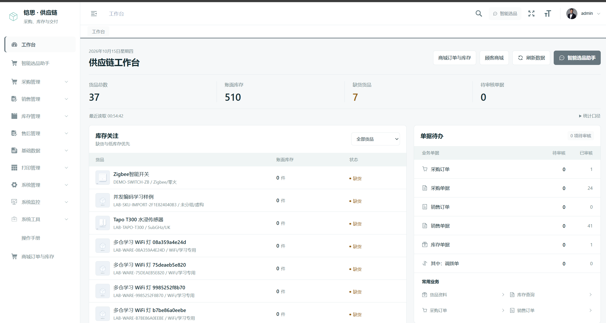
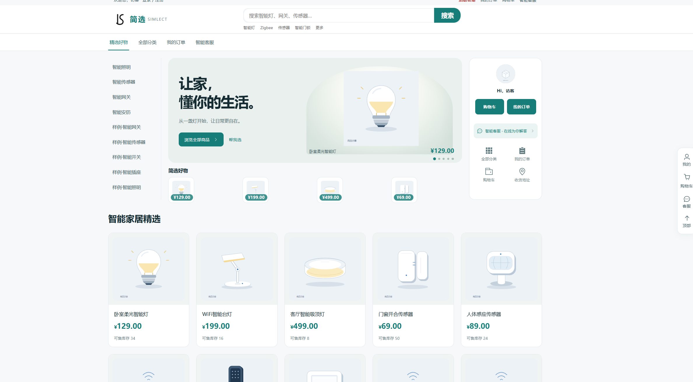
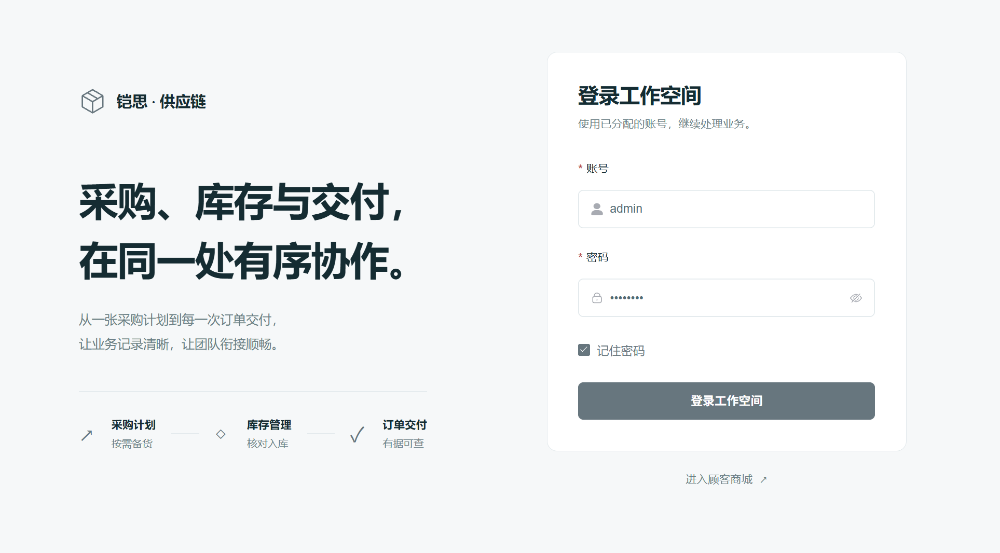

# Supply Chain SaaS AI

**面向智能家居场景的供应链管理与 AI 商城。**

整合商家进销存、消费者购物和 AI 助手，覆盖采购、库存、下单、发货、售后与结算。业务后端采用 Java 单体架构，Python 提供商城 API 适配、商品检索和 Agent 服务，两个 Vue 3 前端分别面向商家与消费者。

项目用于学习和实践供应链业务、SaaS 多租户设计及 AI 工具调用。支付和物流使用模拟渠道，商品资料与演示交易数据用于功能验证。

[功能特性](#功能特性) · [界面预览](#界面预览) · [技术架构](#技术架构) · [开始使用](#开始使用) · [工程验收](#工程验收)

## 功能特性

| 模块 | 主要功能 |
| --- | --- |
| 商家工作台 | 库存关注、单据待办、采购与销售查询、商品缩略图、来源单据追溯 |
| 商品与 SKU | 商品上架、规格管理、SKU 映射、价格与库存查询 |
| 采购与仓储 | 采购订单、分批入库、退供、仓库调拨、多仓订单分配、在途与供货变更 |
| 消费者商城 | 商品浏览与搜索、购物车、下单、支付沙箱、订单查询、活动与秒杀 |
| 订单与售后 | 订单占用、超时释放、部分发货、退货退款、寄回凭证、质检与返库 |
| 成本与结算 | 优惠及运费分摊、成本流水、退款政策、费用审批与支付、经营结果核对 |
| AI 应用 | 关键词与向量检索、RAG 问答、商品选型、经营与备货规划、工具调用及审批任务 |
| SaaS 与权限 | 租户业务库隔离、店铺角色与能力校验、共享会话、操作与执行记录 |

### AI 如何参与业务

消费者可以通过自然语言查找商品、了解设备协议和配套条件；商家可以查询库存、供货及订单事实，形成备货建议和采购任务。

Agent 负责选择工具、检索资料和组织方案。价格、库存、租户权限及单据约束由 Java 业务服务校验，采购执行等写操作遵循业务审批流程。未配置模型时使用规则或检索降级，界面会区分运行方式。

## 界面预览

### 商家工作台

库存关注与单据待办集中展示，可从工作台进入采购、销售、库存和商城订单。



### 消费者商城

提供商品分类、搜索、活动入口与智能客服，商品展示与商家端共用业务库存。



### 登录工作空间



## 技术架构

| 层次 | 技术 | 职责 |
| --- | --- | --- |
| 业务服务 | Java、Spring Boot、Spring Security、MyBatis | 商品、采购、库存、订单、履约、售后与结算 |
| AI 与商城适配 | Python、FastAPI、LangGraph | 消费者 API、检索、Agent 规划和工具调用 |
| 商家前端 | Vue 3、Vite、Element Plus | 供应链管理与商家工作台 |
| 消费者前端 | Vue 3、TypeScript、Vite、Element Plus | 商品浏览、购物车、订单与 AI 客服 |
| 数据与缓存 | MySQL、Redis、SQLite | 业务单据与流水、会话及准入控制、Agent 运行记录 |

MySQL 保存业务单据、库存和交易账本。商城与 ERP 共用库存入口，业务写入统一经过 Java 服务；Python 不直接修改业务库存。

### 项目结构

```text
supply-chain-saas-ai/
├── ks-inventory-system/
│   ├── ruoyi-admin/                 # Java 单体启动入口
│   ├── ruoyi-system/                # 供应链与商城业务
│   └── ks-vue3/                     # 商家工作台
├── fusion-agent/                    # AI Agent 与消费者 API 适配
├── Simlect-AI-Mall/
│   └── Simlect-front/Simlect-web/    # 消费者商城
├── scripts/                         # CI、迁移与业务验收
└── docs/                            # 工程说明和界面截图
```

保留的 `Simlect-AI-Mall/Simlect-backend` 是上游参考代码，当前部署使用上述 Java 单体与 `fusion-agent`。根目录的运行说明对应这套融合后的系统。

## 开始使用

### 环境要求

- JDK 17、Maven 3.9
- Python 3.12 或 3.13
- Node.js 24、npm
- MySQL 8、Redis

```bash
git clone https://github.com/xc1080/supply-chain-saas-ai.git
cd supply-chain-saas-ai
```

### 本地运行

配置数据库、Redis、服务账号和模型参数后，构建 Java 与两个前端，再启动业务服务和 Agent。Windows 环境已有分服务启动脚本及 `start-fusion-demo.ps1`。

完整步骤见 [本地运行说明](本地运行.md)，配置与部署边界见 [工程运行与验收](docs/engineering.md)。启动脚本依赖本机私有配置，仓库不包含数据库密码、模型密钥或现成数据库。

| 服务 | 默认本地地址 |
| --- | --- |
| 商家工作台 | `http://127.0.0.1:5173` |
| 消费者商城 | `http://127.0.0.1:6001` |
| Java 业务服务 | `http://127.0.0.1:8035` |
| Python Agent / 商城 API | `http://127.0.0.1:7050` |

## 工程验收

仓库提供 Java / Python 回归、前端构建及独立 MySQL 业务验收。验收覆盖全新建库、旧版升级、重复启动，以及采购、支付、部分发货、退货返库、费用结算和故障恢复。

- [GitHub Actions](https://github.com/xc1080/supply-chain-saas-ai/actions/workflows/engineering.yml)
- [工程验收记录](工程验收记录.md)
- [验收命令、金额规则与部署说明](docs/engineering.md)

支付及费用支付为 `LOCAL_SANDBOX`，物流为模拟 Provider。真实渠道接入与模型效果需单独验证；容量结果应结合测试机器与流量模型判断。

## 项目来源与参考

- [ks-inventory-system](https://gitee.com/KrityCat/ks-inventory-system)：进销存与后台管理基础。
- [Simlect-AI-Mall](https://github.com/Audreator/Simlect-AI-Mall)：商城界面与 AI 应用参考。
- [RuoYi-Vue-Pro](https://github.com/YunaiV/ruoyi-vue-pro)：采购、SKU、订单等业务设计参考。
- [启航 ERP](https://github.com/zeasin/qihang-erp-open)：渠道 SKU、订单与业务工具设计参考。

各上游项目保留原有源码说明和许可证。使用、分发或进一步开发时，请查看对应目录的许可文件。
